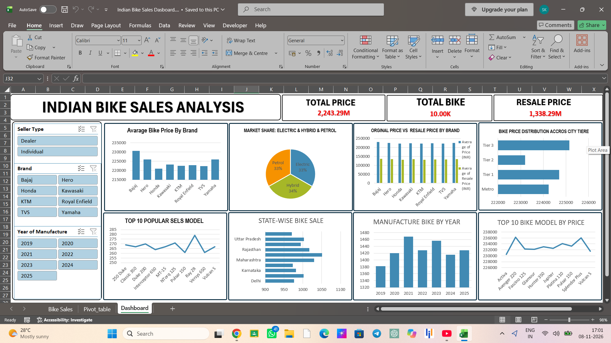

# Indian Bike Sales Analysis Dashboard

## Project Overview
This project analyzes Indian bike sales data using Microsoft Excel. The interactive dashboard provides insights into bike prices, resale prices, market share, popular models, state-wise sales, and manufacturing trends.

## Tools Used
- Microsoft Excel
- Pivot Tables
- Pivot Charts
- Slicers
- Data Analysis & Visualization

## Dashboard Features
- **Total Price:** Overall bike price value
- **Total Bikes:** Total number of bikes analyzed
- **Resale Price:** Total resale price value
- Average Bike Price by Brand
- Market Share of Electric, Hybrid & Petrol Bikes
- Original Price vs Resale Price by Brand
- Bike Price Distribution Across City Tiers
- Top 10 Popular Bike Models
- State-wise Bike Sales
- Bikes Manufactured by Year
- Top 10 Bike Models by Price

## Interactive Filters
The dashboard includes slicers for:
- Seller Type (Dealer & Individual)
- Brand
- Year of Manufacture (2019–2025)

These filters allow users to explore and compare the data interactively.

## Project Objective
The objective of this project is to analyze bike sales data and present useful insights through an interactive Excel dashboard, helping users understand pricing trends, brand performance, resale values, market share, and sales distribution.

## Dashboard Preview

## Key Skills Demonstrated
- Data Analysis
- Data Visualization
- Excel Dashboard Creation
- Pivot Table & Pivot Chart
- Data Filtering
- Business Insights

## Dashboard Preview
## Dashboard Preview

